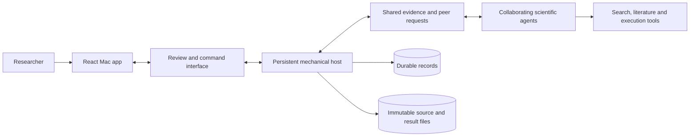

# OpenSource Research Agents

**Collaborative research that stays inspectable—from the source passage to the
reason a conclusion changed.**

This project is building a persistent research workspace in which specialist
agents share evidence, ask one another for help, critique results and develop
follow-up work. Agents can work independently in parallel and return to earlier
questions when new evidence arrives. A mechanical host will preserve work and
coordinate resources; scientific decisions remain with the collaborating agents.

The current release is a **tested foundation and sample Mac app**, not a deployed
autonomous research pipeline. It provides executable interfaces, evaluation
packets, reusable skill packages and small architecture experiments. The default app uses
clearly labeled simulated data. An explicitly launched [local live extension](docs/development/live-research.md)
connects Start and Follow-up to Groq over supplied evidence; it does not search the web.

## Try the foundation

From a checkout, use the shared setup commands:

```sh
scripts/dev bootstrap
scripts/dev setup
scripts/dev check
scripts/dev ui
```

Python 3.12.12, Node 24.21.0 LTS and package-manager versions are pinned.
Bootstrap installs missing tools locally; setup uses committed lockfiles.
No provider keys are needed. See [development setup](docs/development/setup.md)
for prerequisites, optional comparisons and troubleshooting.

On a Mac with Rust 1.93 and Xcode Command Line Tools, build the standalone sample:

```sh
scripts/dev desktop
```

Open `desktop/src-tauri/target/debug/bundle/macos/Research Atlas Sample.app`.
This unsigned development bundle embeds its React assets and needs no Vite server.
The [prototype guide](ui/README.md) explains its review journeys and sample limits.

## What can be inspected today

| Foundation | What it establishes |
| --- | --- |
| Research benchmark packets | Versioned simulated sources, hidden evaluator references, fair-comparison conditions and separate quality/resource measures. |
| Shared interfaces | Typed commands, read models, events, receipts and independent state transitions; Python and JavaScript validate the same fixtures. |
| Recovery examples | Repeated-command handling, missed-event replay, peer-request semantics, delayed operations, pinned model configuration and stale-worker protection. |
| Persistent state and evidence | Versioned SQLite records, immutable source files, stable agent identities, pinned configurations, normalized retrieval receipts and source-to-finding links. [Stage 2 checks](docs/development/stage2-verification.md) exercise recovery and recorded parent/child review without provider calls. |
| Peer coordination and model turns | Durable proposals, reliable peer requests, separate resource permits, concurrent callbacks and exact selected-model request/response records. [Stage 3 checks](docs/development/stage3-verification.md) distinguish offline integration, bounded live protocol proof and the later mission host. |
| Role and skill packages | Nine role definitions, a shared evidence-linking skill and an independent-appraisal skill, with provenance and private attempt state. |
| Runtime and storage experiments | The same scripted collaboration tested through custom asyncio, LangGraph and Microsoft Agent Framework; local SQLite failure and recovery examples. |
| React Mac prototype | Linked findings, source passages, claim versions, peer work, attempts, follow-up requests and separate diagnostics. |

You can inspect the same sample evidence from a terminal or a Codex task:

```sh
.venv/bin/ora inspect-sample --view sources
.venv/bin/ora inspect-sample --view findings
.venv/bin/ora inspect-sample --view diagnostics
```

These commands read the shared sample snapshot. They do not imply a live research
run or certify the scientific validity of the fictional findings.

For the persisted recorded workflow, use Atlas's **Open recorded Stage 2 review**
entry point and the matching [read-only state inspector](docs/development/state-records.md).
Both expose saved sources, exact configuration/input versions and readable agent
steps separately from the findings.

The [Stage 3 collaboration fixture](docs/development/stage3-inspection.md) shows
independent callbacks progressing together, a dependent callback consuming saved
work, and a peer request that remains open. Its Atlas view and command-line
inspection read the same saved records; they do not start a research run.

## Architecture at a glance



The production host and full source adapters in this diagram remain implementation
targets. The optional local live extension exercises a smaller supplied-evidence path. The first
supported design uses SQLite plus immutable files on a single host, with a small
asyncio execution boundary. The Mac shell uses Tauri v2. These decisions are
provisional and include evidence, alternatives and explicit conditions for change.
See [system architecture](docs/architecture/system.md),
[storage](docs/decisions/storage.md), [runtime comparison](docs/decisions/runtime-comparison.md)
and [desktop shell](docs/decisions/desktop-shell.md).

## Read and extend

- [Documentation index](docs/README.md): orientation and implementation evidence.
- [Contract guide](docs/interfaces/contract-guide.md): commands, state, authority and recovery.
- [Benchmark proof matrix](docs/benchmarks/proof-matrix.md): evaluation packets and honest comparison.
- [Roles and skills](docs/development/skills.md): reusable instructions and helper provenance.
- [Module map](docs/development/modules.md): ownership, callers and implemented versus planned commands.
- [Contributing](CONTRIBUTING.md): focused changes, decision rationale and verification.

The existing [classifier example](examples/codiv-classification.mjs) remains
available. Its default mode prints saved example results. The explicit `--live`
mode is separate from the foundation checks and requires its provider credential.

## Scope and evidence

A passing fixture demonstrates the behavior exercised by that fixture. It does
not establish scientific superiority, provider reliability, secure production
isolation or ten-hour endurance. The next implementation stages connect the
authenticated service, persistent research host, provider adapters and real
scientific review. Source-backed decision summaries will remain readable, while
traces and operational metadata remain separately accessible.

This repository is currently developed privately. A redistribution license for
project-owned code has not yet been selected; upstream dependencies retain their
own licenses. No secret or private research corpus is needed for the offline work.
