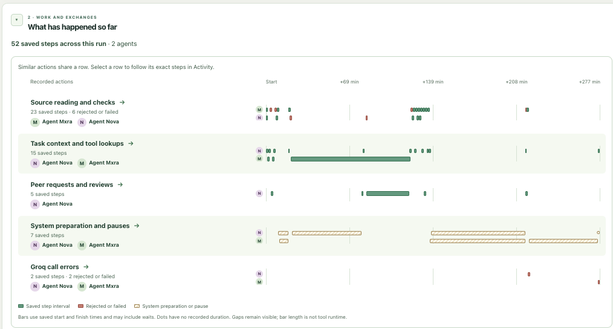
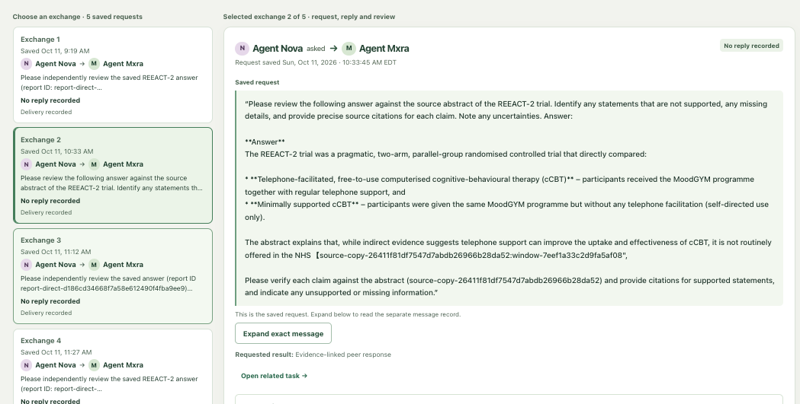
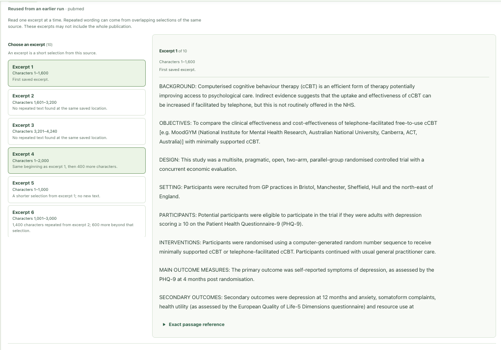
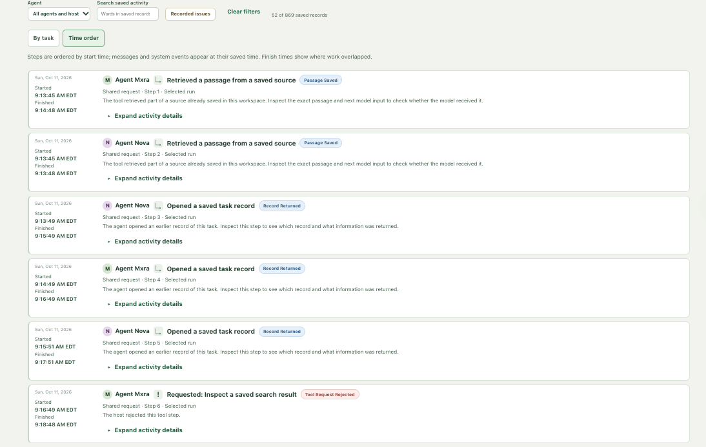
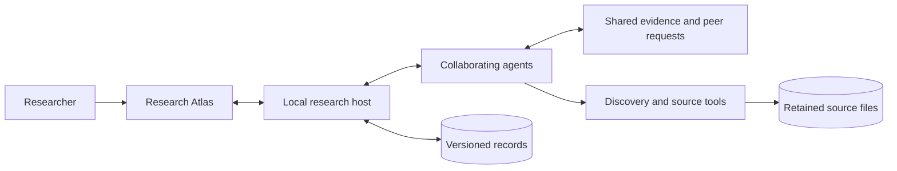

# OpenSource Research Agents

[](https://e2b.dev/startups)

**Research agents that read, question, and build on each other's work.**

OpenSource Research Agents brings persistent agent collaboration and traceable
evidence into **Research Atlas**, a visual workspace for following research from
the initial question to source passages, peer exchanges, and evolving findings.
The aim is to make complex research easier to pursue, inspect, and extend over time.

**Explore:** [The problem](#the-problem) · [The solution](#the-solution) · [How it works](#how-it-works) · [Capabilities](#current-capabilities) · [Run locally](#run-locally) · [Architecture](#architecture-at-a-glance) · [Read and extend](#read-and-extend)



*Research Atlas groups related work into an interactive timeline. Select a row to
explore the saved steps, participating agents, and outcomes behind it.*

## The problem

Research unfolds across papers, notes, analyses, and conversations. As questions
evolve, it becomes difficult to track which sources support a finding, what a
collaborator contributed, and why an interpretation changed. AI can accelerate
individual tasks, but a useful research partner also needs shared context,
durable memory, and work that people can examine.

## The solution

A shared research workspace where agents can pursue complementary tasks, exchange
evidence, request critique, and revisit earlier work. Research Atlas connects
these activities to their sources and saved history, giving researchers a clear
view of both the findings and the process that produced them.

The design separates scientific judgment from execution: **agents choose what to
investigate; the host preserves records, coordinates resources, and manages recovery.**
This supports flexible collaboration while keeping the research history traceable.

## How it works

1. **Frame a question.** Define the scope and choose the starting research peers.
2. **Discover and read.** Agents select searches, inspect publications, and retain source passages with their provenance.
3. **Collaborate.** Peers share work, ask focused questions, and contribute reviews through a persistent research board.
4. **Inspect the evidence.** Follow findings, source copies, peer exchanges, and recorded activity in Research Atlas.
5. **Build on the work.** Start a follow-up from an exact saved result and compare how the evidence and conclusions develop.

## Current capabilities

| Capability | What it brings to the research workflow |
| --- | --- |
| **Scholarly discovery** | Search and publication lookup through PubMed, Europe PMC, Crossref, and optional Exa routes. |
| **Traceable evidence** | Retained source copies, passage locators, reading coverage, and versioned links between evidence and findings. |
| **Persistent collaboration** | Named peers, shared proposals, directed requests and replies, and concurrent execution of independent work. |
| **Model-driven research** | A local research loop connecting selected-model turns, tool use, source inspection, and saved context. |
| **Research Atlas** | Connected views for research review, communication, evidence, activity, saved runs, and report comparison. |
| **Recovery and continuity** | Durable state, exact follow-up references, replay protection, and visible handling of provider waits and interrupted work. |
| **Reusable research roles** | Nine role definitions spanning literature acquisition, synthesis, critique, hypotheses, design, data, analysis, planning, and shared memory. |
| **Reproducible evaluation** | Versioned benchmark packets, shared contract fixtures, behavioral tests, and separate quality and resource measures. |

The current version is a local development workspace with a browser interface
and a native Mac app. The default experience includes recorded examples;
model-backed research uses an explicitly launched local host. Implementation and
evaluation details are collected in the [documentation](docs/README.md).

### Inside Research Atlas

<p>
  <a href="docs/assets/research-atlas-peer-exchange.png"></a>
  <a href="docs/assets/research-atlas-source-reader.png"></a>
  <a href="docs/assets/research-atlas-activity.png"></a>
</p>

*Peer exchanges · Source passages · Recorded activity. Select an image to view it at full size.*

## Why this approach

- **Follow the evidence.** Move from a finding to the source copy and passage behind it.
- **Understand collaboration.** See who contributed, what was exchanged, and how the work progressed.
- **Keep research cumulative.** Preserve earlier results and develop new questions without losing their context.
- **Extend a shared foundation.** Add tools, skills, and research workflows around versioned interfaces and durable records.

## Run locally

### Explore Research Atlas

From the repository root:

```sh
scripts/dev bootstrap
scripts/dev setup
scripts/dev check
scripts/dev ui
```

Bootstrap installs the pinned toolchain locally; setup uses committed lockfiles.
The sample workspace and offline checks need no provider keys. See
[development setup](docs/development/setup.md) for prerequisites and troubleshooting.

### Build the Mac app

With Rust 1.93 and Xcode Command Line Tools installed:

```sh
scripts/dev desktop
```

Open `desktop/src-tauri/target/debug/bundle/macos/Research Atlas Sample.app`.
The development app includes its frontend assets and can also connect to a local
research workspace.

### Start model-backed research

Follow the [local research guide](docs/development/stage4-local.md) to configure
the selected provider and launch the host. The current text research adapter
uses Groq's `openai/gpt-oss-120b`. The guide covers credentials, saved workspaces,
peer selection, follow-ups, and browser or native connections.

## Architecture at a glance



| Layer | Technology and role |
| --- | --- |
| Research interface | React and TypeScript connect findings, evidence, collaboration, and activity; Tauri v2 provides the Mac shell. |
| Research host | Python and asyncio coordinate model turns, tool execution, resources, and recovery. |
| Shared interfaces | Pydantic models generate JSON Schema and TypeScript types for consistent commands and records. |
| Persistent workspace | SQLite and immutable files preserve versioned state, source copies, and research history. |
| Research capabilities | Provider adapters, role definitions, and reusable skills connect discovery, evidence preparation, and review. |

See the [system architecture](docs/architecture/system.md) and
[module map](docs/development/modules.md) for component ownership and design decisions.

## Development direction

The next steps focus on broader scientific-role evaluation, richer source and
figure understanding, longer research workflows, and a persistent service for
ongoing use. The central aim remains the same: collaborative research that grows
more useful over time while keeping its evidence and decisions accessible.

## Read and extend

| I want to… | Start here |
| --- | --- |
| Install, develop, or run checks | [Development setup](docs/development/setup.md) |
| Launch a research workspace | [Local research guide](docs/development/stage4-local.md) |
| Explore the interface | [Atlas guide](docs/development/stage4-atlas.md) · [Sample walkthrough](ui/README.md) |
| Understand discovery and source reading | [Discovery](docs/development/stage4-discovery.md) · [Source intake](docs/development/stage4-intake.md) |
| Extend agents and shared interfaces | [Roles and skills](docs/development/skills.md) · [Contract guide](docs/interfaces/contract-guide.md) |
| Review evaluation evidence | [Benchmark matrix](docs/benchmarks/proof-matrix.md) · [Foundation checks](docs/development/foundation-evidence.md) |
| Contribute a change | [Contributing](CONTRIBUTING.md) · [Module map](docs/development/modules.md) |

Browse the [full documentation index](docs/README.md) for implementation guides,
design decisions, and evaluation records.

## License

A redistribution license for project-owned code has not yet been selected.
Upstream dependencies retain their own licenses.
