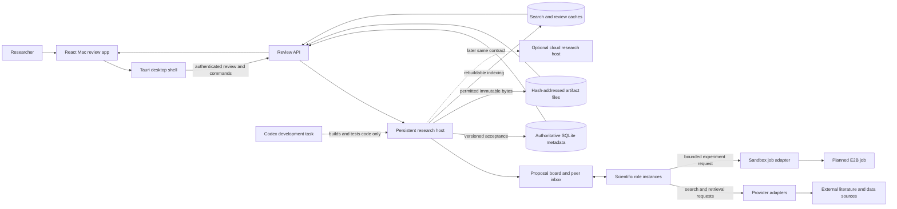
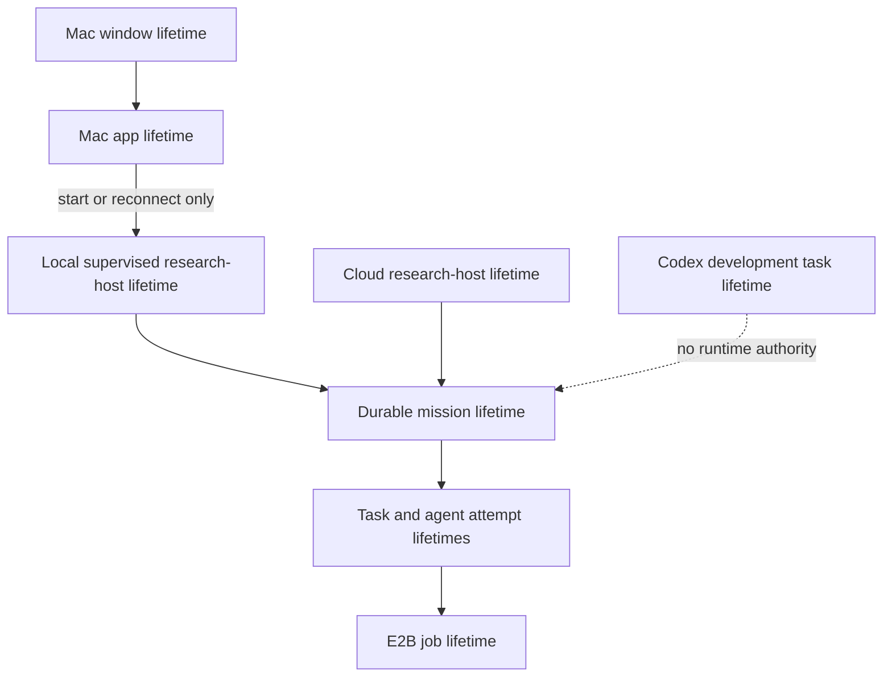

# Stage 1 system architecture

**Design status:** component and authority boundaries for implementation. The runnable research host, peer agents, provider adapters, Mac package and cloud deployment are later work. The [desktop decision](../decisions/desktop-shell.md) selects a first shell; the [storage decision](../decisions/storage.md) selects a first authoritative store. Neither decision is proof of a running pipeline.

## One mission, multiple scientific peers

A mission is a durable research objective, not a desktop window or a single model call. The host may run multiple role instances only when work is useful and admitted by available resources. Source acquisition can use six complementary lanes; synthesis, independent critique, hypotheses, experiment design, data management, analysis, project/collaboration planning, and coordination are capabilities, not a mandatory nine-call stage barrier. Peers exchange proposals, requests, evidence and critique through a durable proposal board. They select scientific alternatives and decide what to investigate next. The host performs mechanical checks and scheduling; it must not choose the scientific answer or suppress an eligible branch for lack of a routine human approval.



The board is a logical shared view over authoritative host records; it is not an independent mutable database. Peers can directly address one another through durable requests and invitations while the host checks identity, authorization, resource admission and valid state transitions. A host lease or quota is a mechanical fact, not a judgment that a hypothesis lacks merit. The source/data adapters return evidence with provenance, access limits and extraction quality; they cannot silently convert a search hit or abstract into full-text support. A sandbox result is evidence for analysis only after the scientific job/result checks; transport success alone is not a valid result.

## Ownership and interfaces

| Component | Owns | May not silently do |
| --- | --- | --- |
| Scientific peer | Choose next question, scientific interpretation, alternative, critique, hypothesis or revision; author a concise evidence-grounded rationale and requests. | Rewrite another peer's accepted version; claim a source passage or experimental result it has not checked; treat private chain of thought as a required artifact. |
| Proposal board | Present versioned peer proposals, invitations, disagreement and work status from authoritative records. | Act as a controlling model planner or independent source of truth. |
| Research host | Mission identity, durable task/attempt/operation state, permissions, resource/quota admission, version checks, commit/outbox, restart/reconciliation and cancellation propagation. | Select the preferred scientific conclusion or globally stop valid work because one branch fails. |
| Provider adapter | Translate a declared retrieval/model request, preserve source/provider/version and actual returned content/status/usage. | Invent a retrieved passage, returned reasoning, success, or a different model setting. |
| Experiment adapter and E2B job | Execute a declared, bounded attempt and return its manifest, outputs, faults and provenance to the host. | Own the mission or promote a computational output into a scientific claim without analysis. |
| Authoritative store and immutable files | Keep versioned accepted workflow/evidence and permitted exact bytes across restart. | Infer truth from a cache, overwrite old source versions, or expose restricted raw reasoning in reports. |
| Review API | Authenticate the shell, serve stable mission/cursor views and accept user steering/cancel commands. | Give the browser direct database, file-system or provider-secret access; serve raw traces as reader findings. |
| React shell | Display reader findings, progress, uncertainties and optional steering; reconnect after UI restart. | Become mission owner, execute unrestricted shell operations from source content, or turn close/quit into implicit cancellation. |

These are conceptual operations, not invented wire endpoints. Shared contracts must later specify IDs, expected versions, operation receipts, auth, cursor pagination, error classes and compatibility. The host should accept a change only if its declared inputs, version, permission and artifact references are valid. It should return an affected-action error when they are not, preserving other branches and any accepted partial work. The app shows a concise report separately from diagnostic traces, provider-returned reasoning and machine state.

## Synthetic evidence-to-revision trace

Suppose a fictional intervention and outcome are under review. One peer requests another to check a reported time point against the source. The acquisition peer obtains a permitted copy with a version/hash and a passage locator. A synthesis peer proposes a claim; critique observes that the claim conflates two time points. The first peer revises the claim, links both the support and the unresolved distinction, and continues the broader mission. This illustrates routing, not a medical or scientific finding.

```mermaid
sequenceDiagram
    autonumber
    participant UI as React review app
    participant H as Durable host/API
    participant B as Proposal board
    participant P1 as Synthesis peer
    participant P2 as Acquisition peer
    participant C as Critique peer
    participant A as Source adapter
    participant F as Immutable files
    participant D as Metadata DB
    participant P3 as Independent branch
    UI->>H: Start synthetic mission with question and selected settings
    H->>D: Commit mission ID, version and initial event
    P1->>B: Request source time-point check from P2
    B->>D: Host commits request and delivery cursor
    P2->>A: Retrieve source with declared query and rights
    A-->>P2: Encounter, copy/version, locator, permitted bytes
    P2->>H: Submit permitted copy and passage contribution
    H->>F: Stage and hash permitted copy
    H->>D: Atomically accept copy, message and event reference
    H-->>B: Publish accepted version to peers
    P1->>H: Propose claim v1 citing passage
    H->>D: Accept claim v1 and support edge
    C->>B: Critique time-point mismatch and request revision
    B->>D: Commit critique/request event
    P1->>H: Propose claim v2 with narrower time point and unresolved edge
    H->>D: Validate expected v1; accept v2 and outbox event
    H-->>UI: Reader finding v2 with cited source and material uncertainty
    P2->>H: Propose malformed action with no required locator
    H-->>P2: Reject this action with repairable locator error
    P2->>B: Request alternate retrieval or repair
    P3->>H: Commit independent valid branch progress
    H->>D: Accept independent event without global pause
```

The peer submits bytes to the host-controlled artifact writer; it does **not** get arbitrary direct file write permission. Every DB acceptance is a host action. A duplicate request after an uncertain response resolves through its stable operation ID. If a copy cannot be retained, the host stores permitted locator/hash/access metadata and labels replay unavailable. The UI can display supported partial findings while the time-point question remains unresolved; it does not require perfect coverage or a fixed number of critique rounds.

## Process and lifetime separation



| Event | Mission state and next action |
| --- | --- |
| Window closes or app quits | Host and accepted mission continue under their own supervisor; reopen UI from mission ID and event cursor. If a local policy intentionally stops the host, record a resumable state; never call it scientific completion. |
| Host process crashes | Restart from durable metadata; reconcile leases, in-flight provider/sandbox effects and outbox before retrying. Preserve unknown outcomes as unknown. |
| Mac sleeps | Work may stop. On wake, compare clocks/leases and actual external effect receipts; continue or recover affected attempts. |
| User explicitly cancels mission | Persist intent, stop admitting new work, propagate cancellation to active operations, reconcile uncertain effects, retain accepted artifacts and cancellation evidence. |
| One branch exhausts a budget or fails | Record branch-local disposition and partial output; ask peers for a different route if useful. Do not equate budget exhaustion with a scientific null result or whole-mission completion. |
| Cloud host replaces local host | Move only through a verified data/identity/version transfer; a Mac window, Codex task and E2B job carry no inherited uptime guarantee. |

The mission has no arbitrary duration or turn cap. Host resource budgets still apply to individual admitted operations. A mission can be paused/resumed at a safe checkpoint without being labeled complete. Positive completion requires a defensible mission-level outcome and disposition of material open branches; that predicate is later runtime work, not implemented here.

## Trust, data and reader boundaries

The browser renderer and retrieved pages are untrusted. UI calls cross an authenticated, narrow API into the host. Provider credentials live only in host-controlled secret storage/environment and are supplied to adapters on demand; they never appear in the React bundle, source copies, event logs or reader report. The host may pass a scoped execution token and declared inputs to a sandbox, not a general research-provider secret. The exact local client authentication and OS keychain mechanism remain implementation choices to test.

Source bytes, extraction spans and claim links follow source rights and version controls. Restricted provider-returned reasoning, if supplied and retainable, is diagnostic data; it is not a model's hidden chain of thought and must not be invented when absent. Reader output contains the supported answer, source/version/locator, meaningful uncertainty and usable next action. Machine traces, retry logs, quota accounting and raw returned reasoning have separate access and retention. Rebuildable indexes cannot become the authority for a claim.

## Decision evidence and qualification work

This architecture is derived from the project's planned peer-science requirements and the two decision records. The SQLite fixture verifies limited local transaction/file behavior; it does not run agents or the desktop shell. The public [synthetic abstract-disagreement scenario](../../benchmarks/v1/scenarios/syn-abstract-disagreement.json) can supply stable source/version/span inputs to a first vertical slice; its evaluator-only answer key must stay outside model-visible state, and the host must still assign durable encounter/copy identities. Implementation should next prove: create a synthetic mission through the API, commit a peer request and a source copy, revise a claim with a cited locator, restart the host, reopen the React view at the same cursor, and show a branch-local malformed-action repair alongside an independent accepted branch. A packaged Mac lifecycle test and later E2B integration then establish their own proof. This order lets builders start locally without treating a stage diagram as working software.
