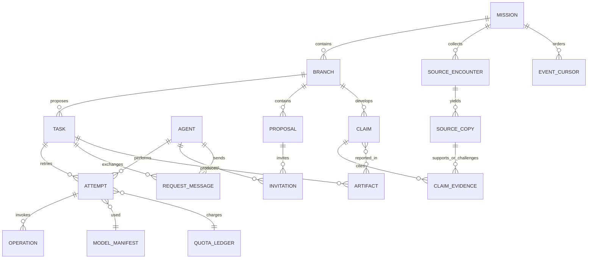

# Storage decision (Stage 1)

**Status:** SQLite on a local filesystem is the first authoritative metadata store; content-addressed immutable files hold retained source bytes and derived artifacts. PostgreSQL is the next candidate if deployment requires independently writing hosts. This decision defines storage boundaries and a tested synthetic fixture. It does not claim that the research runtime, provider retrieval, or cloud storage has been built.

## Workload and selection

The initial research host is one machine with many peer agents and readers but one local authority accepting versioned changes. It needs atomic acceptance of a peer message, source-linked claim, and artifact reference; durable queued work; ordered recovery events; exact source versions; and efficient review/history lookup. Large source/report bytes should not inflate the metadata database. Concurrent access is mediated by the host, and neither the Mac app nor a sandbox writes this store directly.

| Candidate | Atomic workflow/evidence change | Reads, writes, recovery, operations | Fit now |
| --- | --- | --- | --- |
| **SQLite** | One local transaction can accept related metadata and an outbox event together. The [WAL mode](https://www.sqlite.org/wal.html) allows readers alongside one writer, on a local filesystem; it does not make a remote multiwriter database. | Small embedded operational footprint. [Online backup API](https://www.sqlite.org/backup.html) supports a consistent database snapshot. File artifacts still need separate hash verification and backup coordination. Long readers may delay WAL checkpoints. Migrations and backups are host-owned. | **Choose first** for a single authoritative local host. Keep the DB and WAL on the same local disk, set foreign keys, use a controlled writer, test full-disk and crash behavior. |
| **PostgreSQL** | Relational transactions also fit the cross-entity commit. | [MVCC](https://www.postgresql.org/docs/current/mvcc.html) supports concurrent readers/writers; server administration, credentials, and [backup/restore](https://www.postgresql.org/docs/current/backup.html) add deployment work. | Prefer if cloud architecture truly has multiple independent hosts accepting writes, or a managed database is needed. Do not introduce a second authoritative store merely to anticipate this. |
| **MongoDB** | [Multi-document transactions](https://www.mongodb.com/docs/manual/core/transactions/) can span related records, with deployment/session requirements. | Flexible documents help variable payloads, but the mission/source/claim relationships and ordered durable transitions still require disciplined schema, indexes, transaction handling, and [production transaction considerations](https://www.mongodb.com/docs/manual/core/transactions-production-consideration/). | No demonstrated advantage for this relational workload in Stage 1; adds a server and document-relationship discipline. Reconsider only for an evidenced workload change. |

This comparison is based on vendor documentation plus the SQLite fixture below. PostgreSQL and MongoDB were not installed, run, or performance-tested. The fixture cannot establish cloud latency, production durability under power loss, or relative database performance. SQLite's [WAL notes](https://www.sqlite.org/wal.html) specifically rule out using the WAL database through a network filesystem; a cloud deployment must honor the same-host requirement or choose another store.

## Four storage layers

| Layer | Contents and authority | Access, retention, recovery |
| --- | --- | --- |
| 1. Authoritative workflow and evidence metadata | Mission/branch/task/attempt and agent identity; proposal/invitation/request/message; accepted source encounter/copy; claim/support edge; artifact reference; operation state; selected model manifest; quota ledger; ordered event cursor. Versioned rows and an event/outbox record share an acceptance transaction. | Host alone writes. Preserve through app quit/host restart. Restrict diagnostic/reasoning metadata. Retain accepted scientific provenance per a documented policy; do not silently expire a record while a claim depends on it. |
| 2. Immutable bytes | Permitted source copies, structured extraction, experiment inputs/outputs and versioned reader reports in content-hash paths or later object storage. Metadata points to hash, size, media type, source rights, and locator. | Stage/write/sync bytes before metadata acceptance, verify hash on read and backup. Rights can forbid retaining source text: then retain only allowed locator/hash/access limits and mark replay unavailable. Derived reports are not raw source or provider traces. |
| 3. Rebuildable acceleration | Search index, embeddings, summaries, lookup views and local UI caches. | Owner is the host/indexer. Cache deletion or corruption triggers rebuild from layers 1–2 where permitted; it never erases a pending message or changes claim truth. Restricted content cannot be reconstructed if rights disallow retained bytes. |
| 4. Completed-run knowledge | Access-controlled pointers to validated completed-run artifacts, source versions, findings and explicit limitations. | Index over layers 1–2, not a second authority. Later reuse policy decides what another mission may retrieve. Removal from a convenience index does not remove the authoritative run record. |

## Record and version map

These are design relationships, not a frozen public schema. Opaque stable IDs identify entities; integer or content versions distinguish revisions. The host should reject an update against a stale expected version and append an accepted event/outbox entry in the same database transaction. Source identity and content identity are separate.

An encounter records provider, query/request, retrieval time and source locator. A copy records exactly which version/bytes/access depth/parser and rights were observed; two providers can encounter one study, and two copy versions can share or differ in bytes. The content hash may deduplicate identical retained bytes while **each encounter, copy and claim edge remains distinct**. A claim revision carries its own version and links to support, refutation or unresolved evidence edges; a changed copy or parser version makes dependent edges reviewable as stale, rather than rewriting history. A task attempt points to a selected model/settings manifest and operation receipt. The quota ledger records reserved/used/unknown resources; event cursors support restart and review API pagination. Proposals and invitations are durable peer coordination records, not host-authored scientific decisions.

## Accepting bytes and metadata

Files and SQLite do not share one transaction. The safe sequence is deliberately asymmetric:

1. Decide what content may be retained. Assign a copy/artifact ID, expected hash and rights. If bytes cannot be kept, write permitted locator/hash metadata with a replay limitation; do not fabricate a local blob.
2. For retained bytes, write a same-directory temporary file, flush and sync it, atomically rename to the content-hash path, then sync the containing directory. Check an existing hash path before reuse. Only a local filesystem with the required rename/sync semantics qualifies for this sequence.
3. In one short `BEGIN IMMEDIATE` metadata transaction, validate expected entity versions and blob hash/availability, accept the source/copy, message, claim/artifact references and append the event/outbox row. Commit. A unique operation ID makes a retry idempotent after an uncertain response.
4. A recovery worker scans staged and orphan files, reconciles interrupted operations, verifies accepted references on read/backup, and reports missing or corrupt accepted bytes as an affected-artifact integrity fault. It never treats missing content as a successful experiment or an uncited claim. Other branches can continue.

| Interruption | Recoverable observation | Required action |
| --- | --- | --- |
| Before file rename | No accepted metadata; a staged temporary file may remain. | Remove/quarantine stale staged data only after confirming no active writer owns it. |
| After file rename, before DB commit | Valid file exists with no accepted reference (orphan). | Retry the idempotent accept if its inputs/permission still qualify, or retire the orphan after a safe grace/reconciliation period. |
| During metadata transaction | SQLite rolls back the incomplete set; the file may be orphaned. | Reconcile by operation ID; do not expose a partial claim/message/artifact acceptance. |
| After DB commit, before caller receives success | Accepted state exists, response uncertain. | Read by operation ID and return the accepted version rather than writing a duplicate. |
| Accepted reference, file unavailable/corrupt | Metadata survives but the artifact cannot be verified or replayed. | Mark affected artifact/claim use as degraded, restore verified bytes from backup if permitted, retain the fault and provenance, keep unrelated work moving. |

The in-repository fixture tests the middle two boundaries by simulated interruption, not an actual machine power cut. True power-loss durability, outbox delivery, and full host reconciliation are later implementation proofs.

## Migration, backup, retention, and queries

Use a monotonic schema version and migration history. Before an incompatible migration, stop new commits at a recoverable checkpoint, take a verified SQLite online backup and referenced-blob inventory, apply a migration in a transaction where supported, run foreign-key/integrity and representative source→claim→message lookup checks, then resume. A failed migration reopens the prior compatible version from backup; a UI or host update must check protocol/schema compatibility before connecting. Destructive schema changes require an explicit data-conversion and restore test. This is a procedure to implement, not a migration mechanism already present. The first migration fixture should seed a v1 mission, pending peer message, two distinct source encounters sharing bytes, and a cited claim; migrate a v2 copy-rights field, restart, and prove all old IDs/versions and the new field resolve. Inject a failed migration after its first schema operation and restore the v1 snapshot; verify the same links again before resuming writes.

Backup couples an [SQLite online snapshot](https://www.sqlite.org/backup.html) with a manifest of referenced immutable blobs and their hashes/rights. A quiescent point or versioned object-set protocol must prevent retention from deleting a blob while its backup is copying. Restore into a new location, verify hashes and source/claim/message relationships, then switch the host after validation. Do not copy only a live `.db` file while ignoring WAL or artifact bytes. Test a missing-blob restore as a visible degraded state.

Retention is keyed to source rights, mission policy and dependency references. Deleting a cache is always allowed to be followed by rebuild. Deleting restricted source bytes when retention expires must preserve the permitted locator/hash, exact version and fact that replay is unavailable; dependent scientific claims are marked accordingly. Returned provider reasoning belongs in restricted diagnostic storage only if allowed and needed, with its own retention policy. Reader-facing reports are versioned derived artifacts and must not embed restricted traces by accident.

For retrieval, index mission+cursor, branch+status, task+attempt, source canonical/study-family ID, encounter+copy version, claim+revision, and artifact hash/reference; exact indexes are chosen from measured queries. A source/copy/claim version must still be discoverable after cache wipe and restart via authoritative rows. Keep venue catalogs and cross-run indexes rebuildable unless a versioned catalog entry has become an authoritative input to a decision; then preserve that input/version reference.

## Observed fixture and proof boundary

Run `python3 -m unittest discover -s tests/storage -v` and `python3 experiments/storage/sqlite_fixture.py` from the repository root. The fixture uses Python's standard library, synthetic data, a temporary local directory, SQLite WAL and `synchronous=FULL`. It is intentionally not imported by the production host.

On this Apple Silicon macOS 15.5 machine with Python 3.10.4/SQLite 3.37.2, all five tests passed. They observed: a simulated pre-commit exception rolled back **all six** metadata tables and left a detectable orphan file; two encounters with identical bytes kept two encounter/copy records and one hash; deleting an accepted blob produced a missing-reference report while the claim rows remained; a reader kept its old WAL snapshot while a writer committed, and a second immediate writer received `database is locked`; backup/restore preserved the source-copy→claim→message link after cache deletion.

The separate local growth/lookup smoke used distinct synthetic claims rather than only one repeated key:

| Fixture size | Accepted claims | Extra progress events | Claim/source lookups | Files on disk, including WAL and one blob | Batched event insert | Lookup loop |
| --- | ---: | ---: | ---: | ---: | ---: | ---: |
| Small | 10 | 1,000 | 1,000 | 609,598 bytes | 0.000406 s | 0.001869 s |
| Longer synthetic history | 1,000 | 100,000 | 100,000 | 7,944,406 bytes | 0.036942 s | 0.184478 s |

These timings are two uncalibrated observations with one local writer and no source-parser or model work, **not** latency targets, a sustained multi-agent benchmark, or a database comparison.

Unverified: actual kill/power-loss at each boundary, full-disk/permissions failures, sustained multi-agent workload, retention policy implementation, migrations, live provider rights, cloud PostgreSQL, package updates, and restored-host continuation. The implementation should adopt the relationships and failure contract, then qualify the concrete host and its backup/recovery path before claiming durability.
