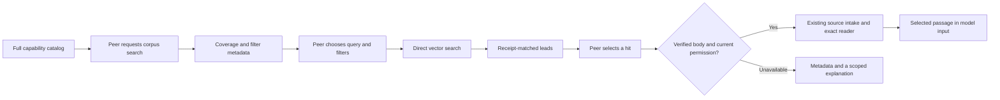

# Optional corpus retrieval

The BHEB route lets a research peer selectively search an existing, privately
configured evidence collection. It uses OpenAI's direct vector-store search API;
it does not create a Responses request, call a generation model, upload files or
modify the remote store. The main research model remains unchanged.

## Agent data flow



`search_bheb_corpus` and `inspect_bheb_hit` are request-first tools. They are
granted to new runs only when their trusted local binding is configured. They do
not replace `search_scholarly`, `search_web` or `search_saved_passages`, and they
are not an automatic fallback. Older runs do not silently gain a new corpus.

The brief catalog description identifies the collection's intended relevance:
behavioral health, digital interventions, product comparisons and research/reporting
guidance. Capability selection supplies a concise summary derived from the
publication receipt before the peer chooses its first query. That summary is
recorded corpus metadata, not a live claim that all relevant literature is covered.
The peer chooses whether the collection fits the information need. It can use
ordinary scholarly or web discovery for missing or poorly matched evidence.

Guidance belongs with these tools and their coverage summary. No additional
mandatory runtime skill or developer API manual is loaded into every model turn.
Existing optional research skills can guide interpretation independently.

## Content and source boundaries

A similarity score ranks a match; it does not establish study quality, population
fit or support for a claim. Metadata may be missing or coarse: inspect its coverage
before filtering. A journal-article label does not establish randomized-trial
design. Several returned chunks may belong to the same publication.

Every match must agree with the selected publication receipt's file identity,
source version and attributes. Unknown files, changed versions and malformed
siblings cannot become checked passages. Valid siblings remain useful. Search
results expose bounded metadata; provider excerpts are not automatically inserted
as checked evidence in model context.

Inspection additionally requires the immutable release manifest, hash-verified
UTF-8 upload body and an explicit current source-use policy. Published abstracts,
full-text-derived material and authored summaries remain distinct. A summary
cannot be promoted to an original published abstract by changing a policy label.

An exact, unique excerpt match supplies its real source location, including when
it occurs late in a long file. A transformed, ambiguous or clipped excerpt does
not justify choosing the first paragraph as a substitute. The existing source
reader remains the route to select exact text. Source intake, use grants,
versioned passage references and model-input checks retain their normal roles.
Receiving a checked passage still does not prove that a model used it correctly.

## Local configuration

The developer/operator supplies two settings through the local environment or
the ignored repository `.env`:

```dotenv
OSRA_OPENAI_API_KEY=
OSRA_BHEB_CONFIG=/absolute/private/path/corpus-config.json
```

The key must access the project owning the selected vector store. The adapter
uses this dedicated key, not a generic `OPENAI_API_KEY` or another application's
credential. Keep real store IDs, publication records, policies and returned
material in private local storage; examples and portable tests use synthetic data.

The configuration binds `publication_receipt_path`, `vector_store_id`, `release_id`
and `release_manifest_checksum_sha256`. `source_manifest_path` and
`source_use_policy_path` enable source inspection only after their identity and
permissions are verified. The policy binds source IDs, versions and upload hashes
to operation-specific storage/model-input permission, rights basis, expiry and
revocation. A reachable store or an `open_full_text` attribute alone does not
establish this authority. Missing source metadata leaves the search route usable
for metadata leads; it does not authorize passage adoption.

## Execution and verification

The adapter saves dispatch state before HTTP and retains completed result identity.
An identical query, filter set and result limit reuse saved results within the same
task and unchanged release/policy binding, even under a new operation ID. Different
queries remain different work; `refresh=true` with a new operation requests fresh
retrieval. Replaying an existing operation never dispatches again. Concurrent callers
share the exact query's dispatch. Unknown dispatch stays uncertain. A rate rejection records a wait;
the route neither silently switches providers nor retries the same uncertain
operation. The fixed OpenAI transport refuses redirects.

The mission executor holds a provider rate wait without an intermediate model
turn. A known rate rejection may retry under a new attempt identity after the
wait; exhaustion returns a bounded failure result so the peer can continue.
An uncertain or completed attempt retains its identity even if host recovery
re-enters the tool with an explicit refresh flag. A genuinely new tool action
can still request fresh retrieval.

The normal retrieval pool limits concurrent tool work. During a bounded
evaluation, the shared HTTP ledger charges actual outbound attempts before
dispatch, including rate-rejected attempts, and survives restart. A denied local
reservation is reported as `not_dispatched` with zero HTTP attempts; an error
after dispatch remains uncertain and charged. Cancellation before execution
sends no request; cancellation during an external call retains its captured
result without accepting it into the cancelled branch.

Receipts distinguish result count, malformed/skipped siblings, clipping, additional
provider pages, elapsed time and HTTP status. Unreported API usage remains unknown.
Store storage bytes are not an account-wide bill; the Responses `file_search`
price must not be assumed to price direct vector-store searches.

Run the focused offline checks after the documented repository setup:

```sh
.venv/bin/python -m pytest -q tests/retrieval/test_bheb.py tests/mission/test_bheb_corpus.py
```

For offline recovery and resource changes, also run
`tests/retrieval/test_bheb_recovery.py`, `tests/retrieval/test_bheb_budget.py`,
`tests/mission/test_bheb_recovery.py`, `tests/mission/test_bheb_attempt_identity.py`
and the shared `tests/retrieval/test_agent_validation_budget.py` regression checks.

These tests use synthetic self-authored source material and injected transports.
They inspect actual serialized callable tools and selected source text, while
separately testing unavailable metadata, ambiguous matches, source-use withdrawal
and replay. They do not prove natural tool choice, real-model understanding or
the scientific adequacy of a private corpus. Saved real provider responses can
be replayed separately without network access. Live generation remains a
separately authorized evaluation.

For offline archive checks and a future article-addition plan, use
[corpus maintenance](corpus-maintenance.md) and the Codex-only
[`os-corpus-maintenance`](../../.agents/skills/os-corpus-maintenance/SKILL.md) skill.

The authoritative protocol is [OpenAI vector-store search](https://developers.openai.com/api/reference/resources/vector_stores/methods/search).
See [retrieval storage pricing](https://developers.openai.com/api/docs/guides/retrieval#pricing)
for the aggregate storage basis; account charges require account evidence.
